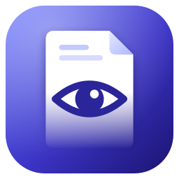
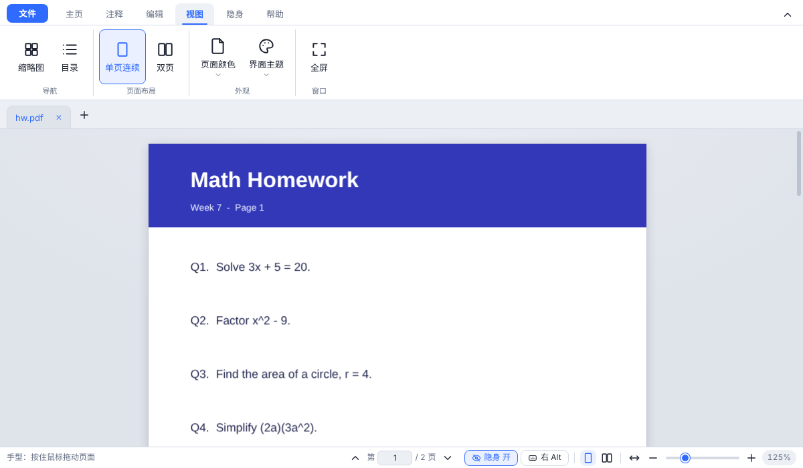
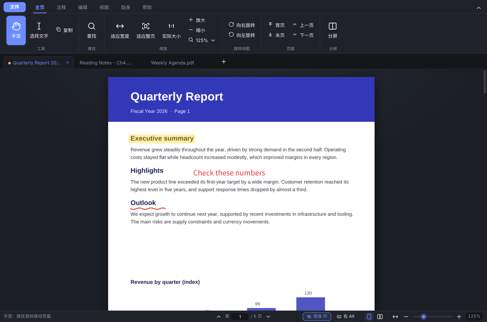
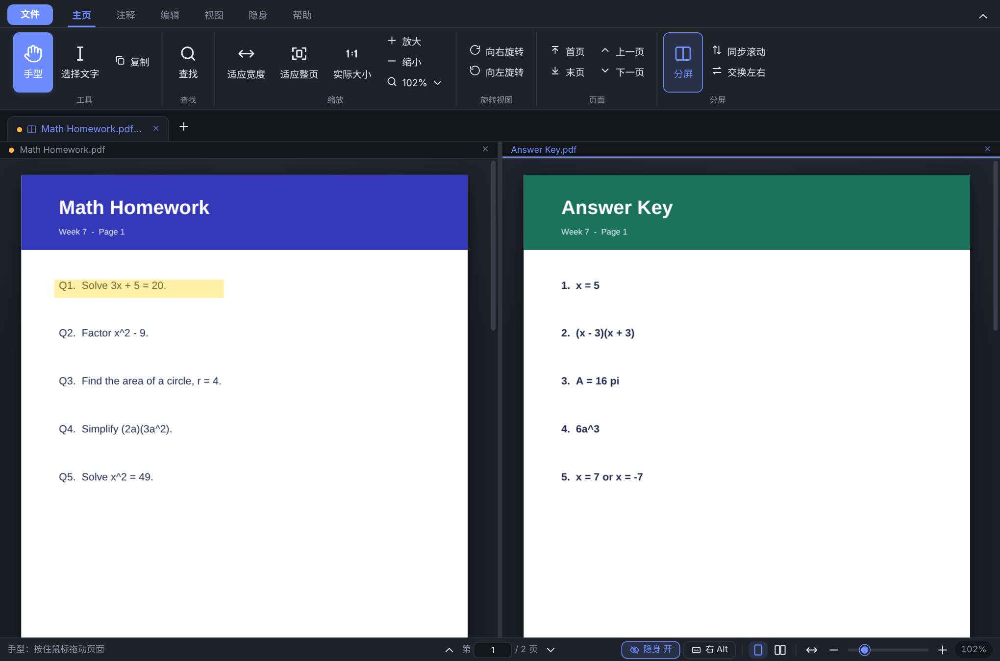
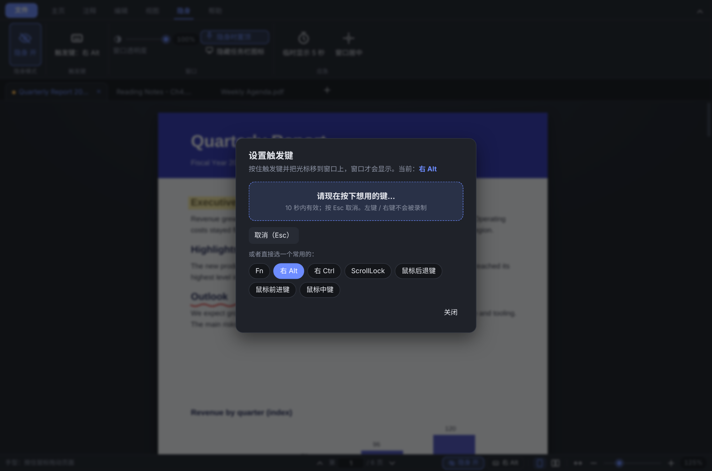
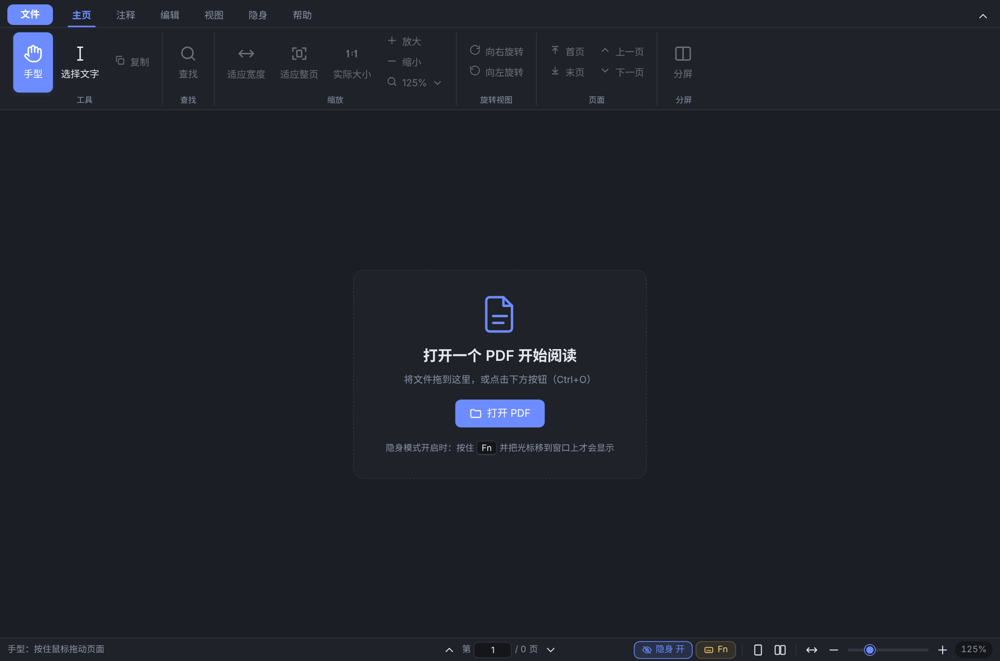

<div align="center">



# StealthPDF

**A Windows PDF reader whose window shows only while you hold a trigger key with the cursor over it**

[](https://github.com/YOUR_GITHUB_USERNAME/stealth-pdf/actions/workflows/ci.yml)
[](LICENSE)

[](https://github.com/YOUR_GITHUB_USERNAME/stealth-pdf/releases)

[简体中文](README.md) | English

</div>

---

## Overview

StealthPDF is an Electron-based PDF reader for Windows. Besides the usual **tabs, annotations and saving**, it has one unusual feature:

> **The window is visible only while the trigger key is held AND the cursor is inside the window.**
> Release the key or move the cursor out, and the window hides immediately.

| Trigger key | Cursor inside window | Window |
|:---:|:---:|:---:|
| released | no | hidden |
| released | yes | hidden |
| held | no | hidden |
| **held** | **yes** | **visible** |

While hidden, the window takes up no screen space, is absent from the taskbar and Alt+Tab, and never intercepts mouse input meant for windows underneath. Its position, open documents and annotations are preserved and come back instantly.

The trigger key is **configurable**: any keyboard key, or the mouse middle / back / forward button.

## Features

- 🙈 **Trigger-to-show** with a configurable trigger key
- 📑 **Tabs**: multiple PDFs, each remembering its own zoom, scroll position and unsaved annotations; drag to reorder
- 🪟 **Split view inside a tab**: two PDFs side by side (check answers, original vs. translation), each with its own scroll, zoom and annotations; optional synced scrolling
- ✋ **Hand tool**: drag to pan; middle-mouse drag pans with any tool
- 🧭 **Ribbon UI** (File / Home / Annotate / Edit / View / Stealth / Help), collapsible, plus a status bar
- 🎨 **Themes**: dark / light / sepia / follow system, and page reading colors (normal / sepia / night)
- 🖍 **Annotations**: text highlight / underline / strikethrough (select text first), area highlight, pen, rectangle, text (CJK supported), eraser, colors, undo & redo; written into the PDF on save
- 📄 **Page editing**: rotate, delete, insert blank page, merge PDFs, extract pages (written on save)
- 🔎 **Reading**: text selection and copy, full-text find, thumbnail / outline sidebar, two-page view, fit page, fullscreen, print, export page as image, document properties, recent files
- 🔍 **Viewing**: continuous scroll, lazy rendering, zoom, fit width, page jump, keyboard paging
- 🪟 **Window opacity** 20%–100% (slider, tray menu, global hotkeys)
- 🔒 **Privacy-friendly**: no network access, no telemetry, no key logging (see [Privacy & Security](#privacy--security))
- 📂 **File association** (installer): double-click a PDF to open it as a new tab in the running window

## Screenshots

<p align="center">
  <br>
  <sub>Light theme and the View ribbon (also dark / sepia / follow system)</sub>
</p>

<p align="center">
  
</p>

<p align="center">
  <br>
  <sub>Split view: homework on the left, answer key on the right, no tab switching</sub>
</p>

<table>
  <tr>
    <td width="50%"></td>
    <td width="50%"></td>
  </tr>
</table>

## Download & Install

Get the latest build from [Releases](https://github.com/YOUR_GITHUB_USERNAME/stealth-pdf/releases):

| File | Description |
|---|---|
| `StealthPDF-Setup-x.y.z.exe` | Installer (recommended). Choose the install directory; optional PDF association |
| `StealthPDF-x.y.z-win-x64.zip` | Portable. Unzip anywhere and run `StealthPDF.exe` |

Requires Windows 10/11 (64-bit). Builds are not code-signed, so SmartScreen may warn: click "More info → Run anyway", or [build from source](docs/BUILDING.md).

## Quick Start

1. After launch the window stays visible for about 4 seconds, then enters stealth mode; a tray icon appears.
2. **Set a trigger key first.** The default is **Fn**, but most keyboards handle Fn in firmware and never report it to Windows. So Fn starts out *unbound*, and while unbound the window stays **always visible** so you are never locked out. Open the Stealth tab in the ribbon (or the status bar) and click the trigger button and bind a key by recording it or choosing a preset (**Right Alt** is a good one).
3. Hold the trigger key and move the cursor onto the window to show it; release or move away to hide it.

## Usage

### Choosing a trigger key

Click the trigger button (Stealth tab or status bar; yellow while unbound) or use the tray menu:

- **Record**: press "Start recording" and hit the key you want within 10 seconds. Any keyboard key works, as do mouse middle / back / forward; left and right clicks are ignored. `Esc` cancels.
- **Presets**: Fn, Right Alt, Right Ctrl, ScrollLock, mouse back / forward / middle.

Right Alt, ScrollLock and F13–F24 are the least intrusive. Avoid Shift/Ctrl (too common), the Win key (opens Start on release) and character keys (they type into other apps).

### Stealth switch

The stealth button (Stealth tab and status bar; also in the tray menu and on `Ctrl+Alt+H`) toggles stealth on/off. With it off, the window is always visible like a normal reader. The window is also kept visible during the first 4 seconds after launch, while file dialogs are open, while a mouse button is held to draw or drag, and while the trigger is unbound.

### Tabs

| Action | Result |
|---|---|
| Open button / `Ctrl+O` / the "+" in the tab bar | Pick files (multi-select), one tab per file |
| Drag PDFs into the window | One tab per file |
| Double-click a PDF (installer, default app) | New tab in the running window |
| Click a tab / `Ctrl+Tab` / `Ctrl+1…9` | Switch tabs |
| × on the tab / middle-click / `Ctrl+W` | Close (asks first if there are unsaved annotations) |
| Drag a tab | Reorder |

Tabs with unsaved annotations show an orange dot. Opening a file that is already open just switches to its tab.

### Split view (two PDFs side by side)

Typical use: check your homework against the answer key, or read an original next to its translation.

| Action | Result |
|---|---|
| Home → "Split" button / `Ctrl+\` | Open another PDF on the right of the current tab. If other single-file tabs exist you can pick "Choose file…" or merge one of them in |
| Click "Split" again | Un-split (closes the right pane) |
| × in a pane header | Close that pane; the other stays in the tab |
| Drag the divider | Resize; double-click to reset to 50% |
| Click a pane / `F6` | Change the focused pane (blue line under its header) |
| Home → "Sync scroll" | One pane scrolls, the other moves by the same distance |
| Home → "Swap" | Swap left and right |

Notes: the two panes are fully independent (zoom, scroll, unsaved annotations, with orange dots on the tab and the pane header). Zoom, page number, undo, save and fit-width act on the **focused pane**; Save writes only that pane's file. Entering split view fits both panes to half width and un-splitting restores the previous zoom. A tab holds at most two panes (no top/bottom split).

### Tools

| Tool | Key | Usage |
|---|:---:|---|
| Hand | `H` | Drag to pan (default tool) |
| Select text | `V` | Drag to select, `Ctrl+C` to copy |
| Text highlight / underline / strikethrough | — | Select text, then click the button in the Annotate tab |
| Area highlight | `M` | Drag a rectangle |
| Pen | `P` | Freehand drawing |
| Rectangle | `R` | Drag a box |
| Text | `T` | Click, type, `Enter` to confirm, `Esc` to cancel |
| Eraser | `E` | Click an unsaved annotation to delete it |

`Ctrl+Z` undoes, `Ctrl+Y` redoes. Saving writes annotations into the PDF and reloads it.

### Shortcuts

| Shortcut | Action |
|---|---|
| **Ctrl+Alt+H** (global) | Toggle stealth |
| Ctrl+Alt+↑ / ↓ (global) | Opacity +10% / −10% |
| Ctrl+O | Open (multi-select) |
| Ctrl+S / Ctrl+Shift+S | Save / Save as |
| Ctrl+Z / Ctrl+Y | Undo / redo annotation |
| Ctrl+F / F3 / Shift+F3 | Find / next / previous |
| Ctrl+P | Print |
| Ctrl+G | Go to page |
| F4 | Sidebar (thumbnails / outline) |
| F11 | Fullscreen (Esc to exit) |
| Ctrl+W | Close tab (whole tab when split) |
| Ctrl+\ | Split / un-split |
| F6 | Switch focused pane in split view |
| Ctrl+Tab / Ctrl+Shift+Tab (or Ctrl+PageDown / PageUp) | Next / previous tab |
| Ctrl+1 … 8 / Ctrl+9 | N-th tab / last tab |
| Ctrl + wheel / Ctrl + `+` / `-` | Zoom |
| Ctrl+0 | Fit width |
| H / V / M / P / T / R / E | Hand / Select / Area highlight / Pen / Text / Rect / Eraser |
| Middle-mouse drag | Pan with any tool |

### Settings and data

Settings and logs live in the app's user-data directory (tray menu → "open log folder"): `settings.json` and `stealth-pdf.log` (rotated at 1 MB). The trigger is stored like this (`code: null` means unbound):

```json
"trigger": { "type": "key", "code": 3640, "label": "Right Alt" }
```

`type` is `key` or `mouse` (mouse codes: 3 middle, 4 back, 5 forward).

> Note: the UI is currently Chinese only.

## Privacy & Security

To know the trigger key state while it is not the foreground app, StealthPDF installs a system-wide input hook via [uiohook-napi](https://github.com/SnosMe/uiohook-napi). So you can audit it:

- **It only checks trigger state.** The hook callback compares key / button codes with the configured trigger; it does not store, log or forward key contents or mouse movement. See `startHook()` in [`main.js`](main.js) and [`trigger.js`](trigger.js).
- **No network.** No requests, auto-update or telemetry.
- **Local writes only**: settings, logs (startup, trigger changes, errors; may include file paths) and PDFs you explicitly save.
- **Antivirus** products may flag global hooks. This is a false positive; verify against the source or build it yourself.
- Report vulnerabilities via [SECURITY.md](SECURITY.md).

> Use it in accordance with the rules of your workplace, school and exams.

## Known Limitations

1. The trigger key's native function still fires (hooks can observe, not suppress). E.g. a mouse back button still navigates in browsers. Prefer side-effect-free keys.
2. Fn usually cannot be detected (see above).
3. If the foreground app runs elevated, a non-elevated StealthPDF receives no input events (UIPI); run StealthPDF as administrator.
4. Saved annotations cannot be edited or deleted. Rotating pages (Edit → Rotate pages) is refused while that page has unsaved annotations; view rotation is display-only and also unavailable while unsaved annotations exist.
5. Encrypted PDFs can be read after entering the password, but cannot be saved with annotations or page-edited.
6. Existing annotations/text cannot be edited; only new ones can be added.
7. CJK text annotations need `simhei.ttf` or `msyh.ttf` from Windows; otherwise non-ASCII characters become `?`.
8. Save overwrites the original file; use Save as for important documents.
9. Quitting the app does not warn about unsaved annotations (closing a tab or pane does); tabs and split layout are not restored on next launch.
10. Split view has at most two side-by-side panes; no top/bottom split and no drag-a-tab-to-a-side yet.
11. Windows 10/11 only.

See [docs/TROUBLESHOOTING.md](docs/TROUBLESHOOTING.md) for help.

## Build from Source

Requires Node.js ≥ 22.12.

```bash
git clone https://github.com/YOUR_GITHUB_USERNAME/stealth-pdf.git
cd stealth-pdf
npm install
npm start        # run
npm test         # unit tests
npm run dist     # build installer (run on Windows)
```

See [docs/BUILDING.md](docs/BUILDING.md) and [docs/ARCHITECTURE.md](docs/ARCHITECTURE.md).

## Contributing

Issues and PRs are welcome; read [CONTRIBUTING.md](CONTRIBUTING.md) first. Ideas: restore tabs and split layout on launch, OCR, editing existing annotations, more print options tested on real printers, i18n.

## License

[MIT](LICENSE) © StealthPDF contributors. Third-party notices: [THIRD_PARTY_NOTICES.md](THIRD_PARTY_NOTICES.md).

## Acknowledgments

[Electron](https://www.electronjs.org/) · [PDF.js](https://github.com/mozilla/pdf.js) · [pdf-lib](https://github.com/Hopding/pdf-lib) · [uiohook-napi](https://github.com/SnosMe/uiohook-napi) · [Lucide](https://lucide.dev/)
