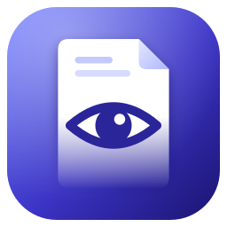
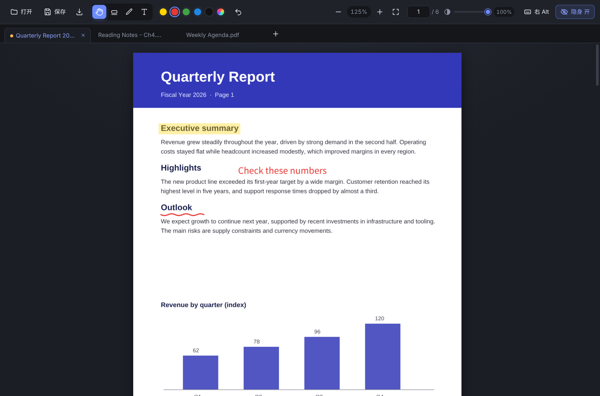
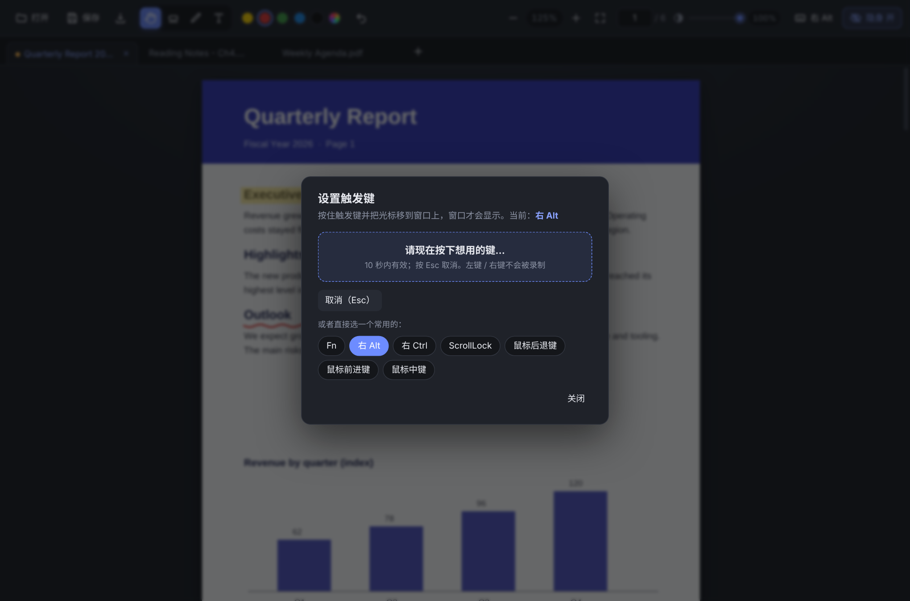
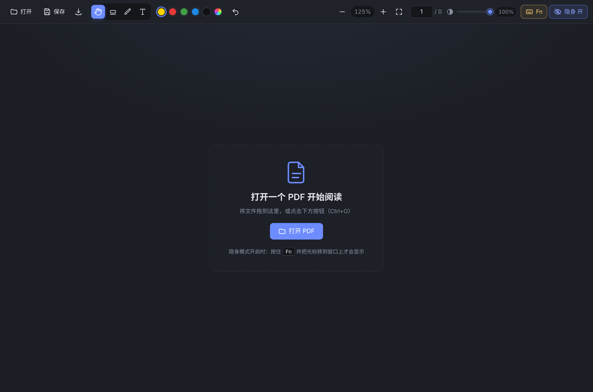

<div align="center">



# StealthPDF

**一个「按住触发键、并把光标移到窗口上才显示」的 Windows PDF 阅读器**

[](https://github.com/YOUR_GITHUB_USERNAME/stealth-pdf/actions/workflows/ci.yml)
[](LICENSE)

[](https://github.com/YOUR_GITHUB_USERNAME/stealth-pdf/releases)

简体中文 | [English](README.en.md)

</div>

---

## 简介

StealthPDF 是一个基于 Electron 的 Windows PDF 阅读器。除了常规的**多标签阅读、标注、保存**之外，它有一个独特的功能：

> **只有「按住触发键」且「鼠标光标在阅读器窗口范围内」这两个条件同时满足时，窗口才会显示。**
> 松开触发键，或光标移出窗口，窗口立刻隐藏。

| 触发键 | 光标在窗口范围内 | 窗口 |
|:---:|:---:|:---:|
| 未按住 | 否 | 隐藏 |
| 未按住 | 是 | 隐藏 |
| 按住 | 否 | 隐藏 |
| **按住** | **是** | **显示** |

隐藏时窗口不占任何屏幕区域、不出现在任务栏和 Alt+Tab 里，也不会拦截你对下面窗口的鼠标操作；窗口的位置、已打开的文档和标注都原样保留，再次触发时瞬间回到原位。

触发键**可以自定义**：键盘上任意一个键，或鼠标的中键 / 后退键 / 前进键。

## 特性

- 🙈 **触发显示**：触发键 + 光标在窗口内才显示；触发键可自定义（见[设置触发键](#设置触发键)）
- 📑 **多标签页**：同时打开多个 PDF，每个标签独立记住缩放、滚动位置和未保存的标注；支持拖动排序
- ✋ **手型工具**：按住鼠标拖动页面平移；任何工具下按住鼠标中键也能平移
- 🖍 **标注**：高亮、画笔、文字（支持中文），可选颜色，撤销，保存时真正写入 PDF
- 🔍 **查看**：连续滚动、懒加载（大文件也流畅）、缩放、适应宽度、页码跳转、键盘翻页
- 🪟 **窗口透明度**：20%–100% 可调（滑块 / 托盘菜单 / 全局快捷键）
- 🌓 **现代深色界面**，窗口会记住设置
- 🔒 **隐私友好**：不联网、无遥测、不记录任何按键内容（见[隐私与安全](#隐私与安全)）
- 📂 **文件关联**：安装版可设为 `.pdf` 的默认打开方式，双击在已运行的窗口里新开标签

## 截图

<p align="center">
  
</p>

<table>
  <tr>
    <td width="50%"></td>
    <td width="50%"></td>
  </tr>
  <tr>
    <td align="center">设置触发键：录制任意键，或直接选常用项</td>
    <td align="center">空白状态</td>
  </tr>
</table>

> 截图由真实界面生成，示例 PDF 为程序生成的演示文档。

## 下载与安装

到 [Releases](https://github.com/YOUR_GITHUB_USERNAME/stealth-pdf/releases) 页面下载最新版本：

| 文件 | 说明 |
|---|---|
| `StealthPDF-Setup-x.y.z.exe` | **安装版**（推荐）。中文安装向导，可自选安装目录，可设为 PDF 默认打开方式 |
| `StealthPDF-x.y.z-win-x64.zip` | **免安装版**。解压到任意位置，运行 `StealthPDF.exe` |

系统要求：Windows 10 / 11（64 位）。

> 安装包未做代码签名，Windows SmartScreen 可能提示「未识别的应用」，点「更多信息 → 仍要运行」即可。你也可以自己从源码构建，见 [docs/BUILDING.md](docs/BUILDING.md)。

## 快速上手

1. 启动后窗口会正常显示约 4 秒，随后进入隐身状态，托盘区会出现图标。
2. **先设置触发键。** 默认触发键是 **Fn**，但绝大多数键盘的 Fn 由键盘硬件处理，Windows 收不到它的按键事件（见下方说明）。所以 Fn 默认处于「未绑定」状态，此时窗口会**一直显示**，不会把你锁在外面。
   点工具栏右侧的「Fn」按钮，用「录制」或常用项（推荐 **右 Alt**）绑定一个键。
3. 绑定后，把窗口放在想要的位置，**按住触发键并把光标移到窗口上**，窗口就会出现；松开或移走，窗口消失。

## 使用指南

### 设置触发键

点击工具栏右侧显示当前触发键的按钮（未绑定时为黄色），或在托盘菜单「触发键」里选择：

- **录制**：点「开始录制按键」，在 10 秒内按下想用的键。支持键盘上**任意键**，以及**鼠标中键 / 后退键 / 前进键**；左键、右键不会被录制。录制中按 `Esc` 取消。
- **常用项**：Fn、右 Alt、右 Ctrl、ScrollLock、鼠标后退键 / 前进键 / 中键。

设置会立即生效并被记住。

**关于 Fn 键：** 键盘的 Fn 通常由键盘固件内部处理，不会作为按键发送给 Windows，任何软件都检测不到。如果录制时按 Fn 没有反应（10 秒后提示超时），就是这种情况，请换一个键。少数键盘会上报 Fn，录制时按一下即可绑定。

**怎么选键？**

| 键 | 评价 |
|---|---|
| 右 Alt | **推荐**（全尺寸键盘）。几乎没人用；单独按下松开时可能激活前台软件的菜单栏，无大碍 |
| ScrollLock / F13–F24 | 几乎不会误触，但很多笔记本没有 |
| 鼠标侧键 | 单手方便；但侧键原本的「后退 / 前进」仍会被前台软件收到（见[已知限制](#已知限制)） |
| 左 Ctrl / Shift | 不推荐，太常用 |
| Win 键 | 不推荐，松开会弹出开始菜单 |
| 字母 / 数字 / 符号键 | 不推荐，按住会在别的软件里打出字符 |

### 隐身开关

工具栏最右侧的按钮显示当前状态，点击切换（与托盘菜单、`Ctrl+Alt+H` 同步）：

| 状态 | 行为 |
|---|---|
| **隐身 开** | 只有「按住触发键且光标在窗口内」才显示 |
| **隐身 关** | 窗口一直显示，就像普通阅读器 |

以下情况窗口会**保持显示**，避免操作被打断：启动后的前 4 秒；文件对话框打开期间；在窗口内按住左键拖动（画笔 / 高亮）期间；触发键未绑定。

想持续编辑时，先关闭隐身；改完再打开。

### 多标签页

| 操作 | 效果 |
|---|---|
| 点「打开」/ `Ctrl+O` / 标签栏的「＋」 | 选择文件（对话框里可**多选**），每个文件一个标签 |
| 把多个 PDF 拖进窗口 | 一次性各开一个标签 |
| 双击 PDF（安装版并设为默认） | 在已运行的窗口里新开标签 |
| 点标签 / `Ctrl+Tab` / `Ctrl+1…9` | 切换标签 |
| 标签上的 × / 鼠标中键 / `Ctrl+W` | 关闭标签（有未保存标注时会先确认） |
| 拖动标签 | 调整顺序 |

每个标签**独立**记住缩放、滚动位置和未保存的标注；有未保存标注的标签左侧显示**橙色圆点**。同一文件重复打开不会产生重复标签，而是切到已打开的那个。

### 工具与标注

| 工具 | 快捷键 | 用法 |
|---|:---:|---|
| 手型 | `H` | 按住左键拖动页面平移（默认工具） |
| 高亮 | `M` | 拖拽框选，生成半透明色块 |
| 画笔 | `P` | 按住左键手绘 |
| 文字 | `T` | 点击页面，输入文字，`Enter` 确认、`Esc` 取消 |

在工具栏选颜色（黄 / 红 / 绿 / 蓝 / 黑 / 自定义）。`Ctrl+Z` 撤销当前标签最近一个标注。标注在点「保存」前只存在于内存；保存后会**写入 PDF 文件**并就地重新载入。

### 窗口透明度

工具栏滑块（20%–100%）、托盘菜单「窗口透明度」，或全局快捷键 `Ctrl+Alt+↑` / `Ctrl+Alt+↓`（每次 ±10%，窗口隐藏时也有效）。设置会被记住。

### 托盘菜单

右键托盘图标：隐身模式开关、窗口透明度、触发键、隐身时窗口置顶、隐身时隐藏任务栏图标、**临时显示窗口 5 秒**、**把窗口移回屏幕中央**（窗口跑丢时救急）、打开日志文件夹、退出。

### 快捷键一览

| 快捷键 | 功能 |
|---|---|
| **Ctrl+Alt+H**（全局） | 开 / 关隐身模式（窗口隐藏时也有效，应急开关） |
| Ctrl+Alt+↑ / ↓（全局） | 窗口透明度 +10% / −10% |
| Ctrl+O | 打开 PDF（可多选） |
| Ctrl+S / Ctrl+Shift+S | 保存 / 另存为 |
| Ctrl+Z | 撤销标注 |
| Ctrl+W | 关闭当前标签 |
| Ctrl+Tab / Ctrl+Shift+Tab（或 Ctrl+PageDown / PageUp） | 下一个 / 上一个标签 |
| Ctrl+1 … Ctrl+8 / Ctrl+9 | 第 N 个标签 / 最后一个标签 |
| Ctrl + 滚轮 / Ctrl + `+` / Ctrl + `-` | 缩放 |
| Ctrl+0 | 适应宽度 |
| H / M / P / T | 手型 / 高亮 / 画笔 / 文字 |
| PageUp / PageDown / 空格 / 方向键 / Home / End | 翻页与滚动 |
| 鼠标中键拖动 | 任何工具下平移页面 |

### 配置与数据

设置（隐身开关、透明度、触发键等）和日志保存在应用的用户数据目录。托盘菜单 →「打开日志文件夹」即可到达，里面有：

- `settings.json`：设置，可手动编辑（修改前请先退出程序）
- `stealth-pdf.log`：日志（超过 1 MB 自动轮转为 `.old`）

触发键在 `settings.json` 里长这样（`code` 为 `null` 表示未绑定）：

```json
"trigger": { "type": "key", "code": 3640, "label": "右 Alt" }
```

`type` 为 `key`（键盘）或 `mouse`（`code`：3 中键、4 后退、5 前进）。

## 隐私与安全

StealthPDF 需要「系统级键鼠监听」才能在窗口不在前台时知道触发键是否被按住，所以它会使用一个全局输入钩子（通过 [uiohook-napi](https://github.com/SnosMe/uiohook-napi)）。因此你有理由要求它是可审计的：

- **只判断触发键的状态。** 钩子回调只比较按键 / 鼠标键编号是否等于触发键，不存储、不记录、不转发任何按键内容或鼠标轨迹。相关代码集中在 [`main.js`](main.js) 的 `startHook()` 与 [`trigger.js`](trigger.js)，不到 100 行。
- **不联网。** 程序里没有任何网络请求、自动更新或遥测代码。
- **只写本地文件。** 仅写入用户数据目录里的设置与日志，以及你主动「保存 / 另存为」的 PDF。日志只记录启动、触发键变更、报错和文件读写失败，可能包含文件路径。
- **安全软件提示。** 全局键盘钩子是键盘记录器常用的技术，个别杀毒软件可能对它提示风险。这是误报，你可以对照源码确认，或自行[从源码构建](docs/BUILDING.md)。
- 发现安全问题请看 [SECURITY.md](SECURITY.md)。

> 请在遵守所在场所、学校、公司和考试相关规定的前提下使用本软件。

## 已知限制

1. **触发键本来的功能仍会触发。** 系统钩子只能「监听」，不能拦截。例如选鼠标后退键：窗口尚未显示的那一刻，按键事件仍会交给下面的软件，在浏览器 / 资源管理器里就是「后退」一次。建议选没有副作用的键（右 Alt、ScrollLock、F13–F24），或用鼠标驱动 / X-Mouse Button Control 给常用软件取消侧键功能。
2. **Fn 键通常无法使用**（见上）。
3. **前台是以管理员身份运行的程序时**，普通权限的 StealthPDF 收不到输入事件（Windows UIPI 限制）；此时请以管理员身份运行 StealthPDF。
4. **页面带旋转属性（/Rotate）** 时，保存后的标注位置可能偏移。
5. **加密 PDF** 暂不支持打开。
6. **不能编辑 / 删除 PDF 里原有的标注，也不能修改原文字**，只能叠加新标注；撤销只对尚未保存的标注有效。
7. **中文文字标注**依赖 Windows 的 `simhei.ttf`（黑体）或 `msyh.ttf`；找不到字体时，非 ASCII 字符会被替换成 `?`。
8. **「保存」会覆盖原文件**，重要文件请先备份或使用「另存为」。
9. **关闭整个程序时不会提醒未保存的标注**（只有关闭单个标签才会确认）；**标签不会跨次启动保留**。
10. 仅支持 Windows 10 / 11（隐身逻辑依赖 Windows 的窗口与输入行为）。

## 常见问题

遇到问题请先看 [docs/TROUBLESHOOTING.md](docs/TROUBLESHOOTING.md)，里面有：窗口一直显示 / 不显示、触发键没反应、打包报错（Visual Studio、GitHub 超时、符号链接）、安装版找不到字体等。

## 从源码运行与构建

需要 Node.js ≥ 22.12。

```bash
git clone https://github.com/YOUR_GITHUB_USERNAME/stealth-pdf.git
cd stealth-pdf
npm install
npm start          # 开发运行
npm test           # 单元测试
npm run dist       # 构建安装包（在 Windows 上执行）
```

详细步骤、免安装版、镜像与代理设置见 [docs/BUILDING.md](docs/BUILDING.md)；整体设计见 [docs/ARCHITECTURE.md](docs/ARCHITECTURE.md)。

## 参与贡献

欢迎提 Issue 和 Pull Request！请先阅读 [CONTRIBUTING.md](CONTRIBUTING.md)。一些值得做的方向：

- 启动时恢复上次打开的标签；退出前提醒未保存的标注
- 文字选择与全文搜索
- 编辑 / 删除 PDF 里已有的标注
- 页面旋转时标注坐标的修正
- 英文界面（i18n）

## 许可证

[MIT](LICENSE) © StealthPDF contributors。第三方组件及其许可证见 [THIRD_PARTY_NOTICES.md](THIRD_PARTY_NOTICES.md)。

## 致谢

[Electron](https://www.electronjs.org/) · [PDF.js](https://github.com/mozilla/pdf.js) · [pdf-lib](https://github.com/Hopding/pdf-lib) · [uiohook-napi](https://github.com/SnosMe/uiohook-napi) · [Lucide](https://lucide.dev/)
